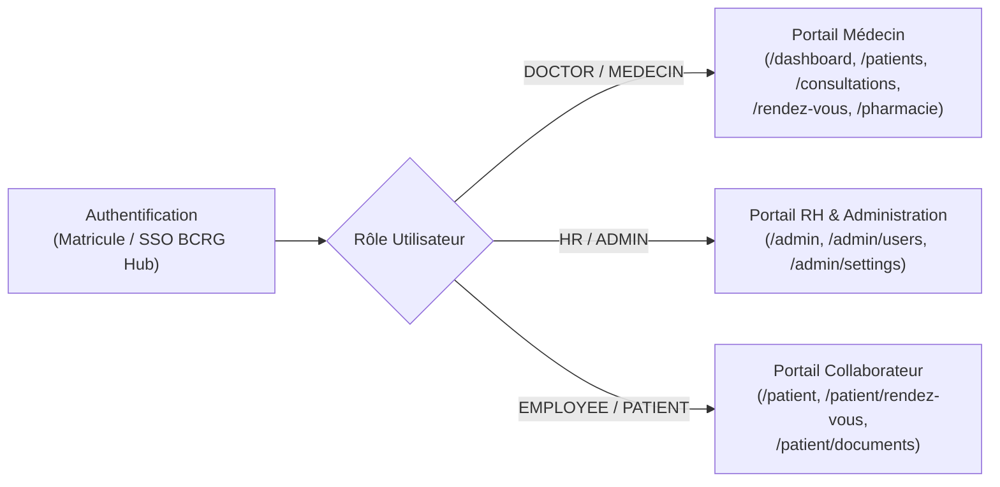

# Documentation Fonctionnelle — MedBCRG

## 1. Contexte et Objectifs du Système

**MedBCRG** est le système d'information médical de l'infirmerie de la **Banque Centrale de la République de Guinée (BCRG)**. Il répond à quatre enjeux majeurs :

1. **Suivi clinique et médical des agents** : Centraliser le dossier médical de chaque collaborateur (constantes vitales, groupe sanguin, allergies, antécédents, historique des consultations et ordonnances).
2. **Suivi spécialisé du diabète et des consommables** : Assurer le suivi des collaborateurs diabétiques, tracer chaque contrôle de glycémie capillaire et décompter automatiquement la consommation des bandelettes glycémiques (`GLUCOSE_STRIPS`).
3. **Pilotage de la santé au travail (RH)** : Suivre le taux de couverture des visites médicales périodiques obligatoires (**Visite Standard** vs **Suivi Médical Renforcé — SMR**), les arrêts de travail par direction et générer les rapports officiels RH.
4. **Confidentialité et Secret Médical (RBAC strict)** : Garantir que seuls les médecins accèdent aux diagnostics, symptômes, résultats cliniques et ordonnances, tandis que la Direction des Ressources Humaines (RH) n'accède qu'aux indicateurs administratifs anonymisés, aux durées d'arrêt de travail et aux échéances de visites périodiques.

---

## 2. Acteurs et Rôles du Système

Le système s'articule autour de trois profils d'utilisateurs distincts, chacun disposant d'un portail dédié :

| Rôle Backend | Rôle Frontend | Acteur Métier | Périmètre d'accès |
| :--- | :--- | :--- | :--- |
| `DOCTOR` | `MEDECIN` | Médecin du travail / Infirmier | Accès complet aux dossiers médicaux, consultations, constantes, glycémie, allergies, agenda médical, génération de documents PDF et suivi des bandelettes. |
| `HR` | `ADMIN` | Administrateur RH / DRH | Gestion administrative des collaborateurs (création, import CSV, mise à jour administrative), paramétrage des périodicités de visite, suivi des échéances, statistiques RH par direction et export PDF du rapport RH. **Aucun accès au secret médical.** |
| `EMPLOYEE` | `PATIENT` | Collaborateur / Agent BCRG | Consultation de son espace santé personnel (dernières constantes, groupe sanguin), prise et annulation de rendez-vous en ligne, téléchargement de ses documents médicaux et téléversement de pièces externes. |

---

## 3. Fonctionnalités Détaillées par Portail

### 3.1. Portail Médecin (`MEDECIN`)

#### A. Tableau de Bord Clinique (`/dashboard`)
- **Indicateurs clés (KPIs)** :
  - Nombre de patients vus aujourd'hui.
  - Urgences médicales / cas prioritaires pris en charge.
  - Demandes de rendez-vous à venir.
  - Volume total des consultations du mois en cours.
- **Suivi Diabète & Stock Bandelettes** :
  - Nombre de patients diabétiques identifiés dans l'effectif.
  - Nombre total de contrôles glycémiques réalisés.
  - Nombre de bandelettes consommées et stock restant en temps réel.
  - **Tableau des passages glycémiques du mois** : liste nominative des agents diabétiques suivis dans le mois avec leur matricule, direction, nombre de passages et valeur du dernier relevé glycémique (ex. `1.1 g/L`).
- **Activité hebdomadaire & Consultations récentes** : Historique rapide des dernières consultations avec accès direct au dossier.

#### B. Répertoire des Dossiers Patients (`/patients`)
- **Recherche et filtrage** : Recherche instantanée par nom, prénom, matricule ou direction.
- **Création d'un nouveau patient (`+ Nouveau Patient`)** : Permet au médecin d'enregistrer un nouveau collaborateur en urgence ou lors d'une visite d'embauche (matricule numérique, identité, genre, direction, poste, groupe sanguin, antécédents).
- **Tiroir du Dossier Médical Complet** :
  - **Identité & Profil** : Matricule, direction, poste, groupe sanguin, antécédents médicaux.
  - **Gestion des Allergies** : Ajout d'une allergie (type : Médicamenteuse `DRUG`, Alimentaire `FOOD`, Professionnelle `OCCUPATIONAL`, Autre `OTHER` ; substance ; sévérité : Légère `MILD`, Modérée `MODERATE`, Sévère `SEVERE` ; détails de la réaction) et suppression.
  - **Historique des Constantes Vitales** : Tension artérielle, poids, taille, température, IMC calculé automatiquement et son interprétation clinique (`Poids normal`, `Surpoids`, `Obésité`, etc.).
  - **Historique des Contrôles Glycémiques** : Valeurs mesurées et horodatage.
  - **Historique des Consultations & Documents PDF** : Prévisualisation et téléchargement en un clic des ordonnances, certificats et résultats d'examens rattachés au patient.

#### C. Gestion des Consultations (`/consultations`)
- **Filtres multicritères** : Recherche textuelle, filtrage par statut (`Terminée`, `En cours`, `En attente`), par type (`Consultation Générale`, `Visite Périodique`, `Soins / Urgence`) et par date.
- **Création d'une consultation** :
  - Sélection du collaborateur par matricule ou nom.
  - Choix du type de consultation (`GENERAL`, `PERIODIC`, `INSTANT`).
  - Saisie des **constantes vitales** : Tension artérielle (ex. `120/80`), Poids (`kg`), Taille (`cm`), Température (`°C`), Pouls, SpO2 et **Groupe Sanguin**.
  - Saisie du **contrôle glycémique** (case à cocher *Test de glycémie effectué* + valeur en `g/L`). Chaque test coché décrémente automatiquement d'une unité le stock de bandelettes `GLUCOSE_STRIPS`.
  - Saisie clinique : Motif/Symptômes, Diagnostic médical, Conseils/Notes.
  - **Prescriptions médicamenteuses** : Ajout de lignes de prescription (médicament, posologie, durée, quantité).
- **Tiroir de détail d'une consultation & Actes Médicaux PDF** :
  - Modification en direct du **Groupe Sanguin** du patient via la consultation.
  - Ajout/suppression d'allergies directement depuis la consultation.
  - **Génération d'Ordonnance Médicale (PDF)** : Génère, archive dans le dossier patient et ouvre le PDF officiel signé.
  - **Génération de Certificat d'Aptitude (PDF)** : Choix de l'avis (`Apte`, `Apte avec restrictions`, `Inapte temporaire`, `Inapte définitif`), réserves éventuelles et génération du PDF officiel.
  - **Génération de Repos Médical / Arrêt de travail (PDF)** : Saisie de la date de début, date de fin, nombre de jours et motif administratif, avec génération du certificat PDF et prise en compte immédiate dans les compteurs RH d'arrêts de travail.

#### D. Agenda Médical & Rendez-vous (`/rendez-vous`)
- **Vues Calendrier** : Navigation par **Jour**, **Semaine** ou **Mois** sur les créneaux réglementaires (`08:00` à `17:00`, par tranches de 30 minutes).
- **Actions du médecin sur un rendez-vous** :
  - **Approuver / Confirmer** une demande de rendez-vous collaborateur (`CONFIRMED`).
  - **Reporter (Reprogrammer)** à une nouvelle date et un nouveau créneau horaire disponible (`RESCHEDULED`).
  - **Annuler** avec motif d'annulation (`CANCELLED`).

#### E. Pharmacie & Consommables (`/pharmacie`)
- Suivi dédié du stock de **Bandelettes de contrôle glycémique (`GLUCOSE_STRIPS`)** :
  - Jauge visuelle du stock restant par rapport au stock initial.
  - Compteurs de consommation liée aux contrôles glycémiques effectués en consultation.
  - Tableau récapitulatif des passages glycémiques mensuels par collaborateur.

---

### 3.2. Portail RH & Administration (`ADMIN`)

#### A. Tableau de Bord Admin & RH (`/admin` / `/admin/stats`)
- **Indicateurs de pilotage RH** :
  - **Taux de couverture médicale (%)** : Proportion des employés dont la visite médicale périodique est à jour.
  - **Visites échues (En retard)** : Nombre de collaborateurs ayant dépassé leur date d'échéance (relance prioritaire).
  - **Employés suivis** : Effectif total actif enregistré.
  - **Arrêts de travail en cours** et **Jours d'arrêt cumulés** sur la période filtrée.
- **Indicateurs Diabète & Consommation Bandelettes (vue RH anonymisée)** :
  - Nombre global de patients diabétiques, nombre de contrôles réalisés, bandelettes consommées et stock restant (sans divulgation de l'identité médicale des patients).
- **Répartition par Direction (BCRG)** :
  - Pour chaque direction : effectif, nombre de consultations réalisées et total des jours d'arrêt de travail sur la période sélectionnée (`Aujourd'hui`, `Cette semaine`, `Ce mois`, `Cette année`, `Toutes les dates`).
- **Export Officiel RH (PDF)** :
  - Bouton **Exporter le rapport (PDF)** générant un document institutionnel complet de synthèse RH.

#### B. Périodicité des Visites Obligatoires (`/admin/settings`)
- **Paramétrage des règles de périodicité** :
  - **Visites Périodiques Standards** : `6`, `12`, `24` ou `36` mois (par défaut `12 mois`).
  - **Suivi Médical Renforcé (SMR)** : `3`, `6` ou `12` mois (par défaut `6 mois`). S'applique automatiquement aux postes à risques particuliers (chauffeurs, agents de sécurité, manipulateurs de fonds, ou agents présentant une pathologie chronique suivie).
  - **Délai de Relance RH** : `15`, `30`, `45` ou `60` jours avant l'échéance (par défaut `30 jours`), déterminant le passage au statut **« Bientôt due »**.
- **Tableau des Échéances des Visites Médicales Périodiques** :
  - Liste complète des collaborateurs avec matricule, nom, badge `SMR` éventuel, direction, date de dernière visite, date de prochaine échéance et statut (`À jour`, `Bientôt due`, `En retard`).

#### C. Gestion des Comptes Collaborateurs (`/admin/users`)
- **Vue tabulaire et filtres** : Recherche par nom/matricule/email, filtres par rôle, statut de compte, statut de visite obligatoire (`À jour`, `Bientôt due`, `En retard`) et direction.
- **Ajout unitaire d'un employé** : Création simultanée du compte utilisateur et du dossier administratif patient.
- **Modification du profil administratif** : Mise à jour du téléphone, de la direction, de l'intitulé de poste, du groupe sanguin et des notes de dossier.
- **Import / Export CSV en masse** :
  - **Import CSV** : Chargement d'un fichier `.csv` (colonnes `matricule;prenom;nom;genre;email;telephone;direction;poste`) pour créer plusieurs collaborateurs en lot.
  - **Export CSV** : Extraction de la liste des collaborateurs et de l'état de leurs visites médicales au format compatible Excel (UTF-8 avec BOM).

---

### 3.3. Portail Collaborateur / Patient (`PATIENT`)

#### A. Mon Espace Santé (`/patient`)
- **Bannière de rappel dynamique** : Alerte automatiquement le collaborateur lorsqu'il a un prochain rendez-vous programmé ou confirmé, avec la date et l'heure exactes.
- **Prochain Rendez-vous** : Visualisation du prochain rendez-vous et panneau latéral **Gérer** permettant d'annuler un rendez-vous à venir.
- **Dernières Constantes** : Affichage de la dernière tension artérielle mesurée, du dernier poids et de la date du dernier relevé.
- **Suivi et Documents** : Accès direct en lecture et téléchargement aux documents médicaux (ordonnances, certificats d'aptitude, repos médicaux, bilans).

#### B. Prise de Rendez-vous en Ligne (`/patient/rendez-vous`)
- **Calendrier mensuel intelligent** :
  - Affiche pour chaque jour ouvré futur le nombre exact de créneaux disponibles (ex. `19 créneaux`) ou la mention `Complet`.
  - Désactive automatiquement les week-ends et les dates passées.
- **Sélection du créneau et réservation** :
  - Affichage des créneaux horaires libres entre `08:00` et `17:00` (pas de 30 minutes).
  - Choix du type de consultation (`Consultation Générale`, `Visite d'embauche`, `Visite Annuelle`, `Consultation Spécialisée`) et saisie du motif.

#### C. Mes Documents Médicaux (`/patient/documents`)
- Consultation et téléchargement des documents générés par le médecin.
- **Téléversement de document externe** : Possibilité pour le collaborateur d'ajouter un résultat d'analyse externe ou une pièce médicale (PDF, PNG, JPEG jusqu'à 10 Mo) dans son dossier médical.

---

## 4. Règles de Gestion Métier Essentielles

1. **Format du Matricule** : Le matricule d'un collaborateur est composé exclusivement de chiffres (`/^[0-9]+$/`, minimum 4 caractères, ex. `1088`, `2007`, `3003`).
2. **Détection automatique du profil SMR (Suivi Médical Renforcé)** :
   Un employé est classé en suivi SMR si son intitulé de poste ou sa direction correspond à un poste à risque (chauffeur, conducteur, sécurité, garde, caisse, manipulation de fonds) ou si son dossier mentionne une affection chronique nécessitant une surveillance rapprochée (ex. diabète, hypertension). Sa périodicité de visite obligatoire passe alors de la fréquence standard (12 mois) à la fréquence SMR (6 mois).
3. **Calcul du statut de visite périodique** :
   - **En retard (`OVERDUE` / `EN_RETARD`)** : Aucune visite enregistrée ou date d'échéance dépassée (`daysRemaining < 0`).
   - **Bientôt due (`DUE_SOON` / `BIENTOT_DUE`)** : Date d'échéance comprise entre aujourd'hui et le délai de relance configuré (`0 <= daysRemaining <= reminderLeadDays`).
   - **À jour (`UP_TO_DATE` / `A_JOUR`)** : Date d'échéance supérieure au délai de relance (`daysRemaining > reminderLeadDays`).
4. **Décompte automatique des bandelettes glycémiques** :
   Le stock restant de bandelettes (`GLUCOSE_STRIPS`) est calculé dynamiquement à partir du stock initial configuré moins le nombre total de contrôles glycémiques (`GlycemiaCheck` avec `performed = true`) enregistrés lors des consultations.

