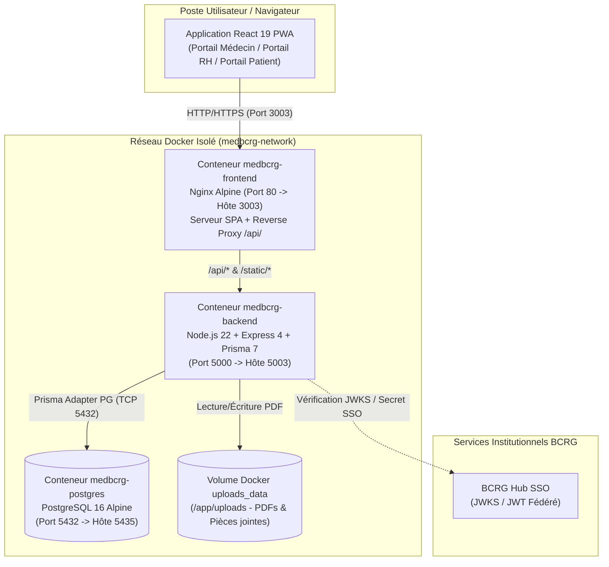
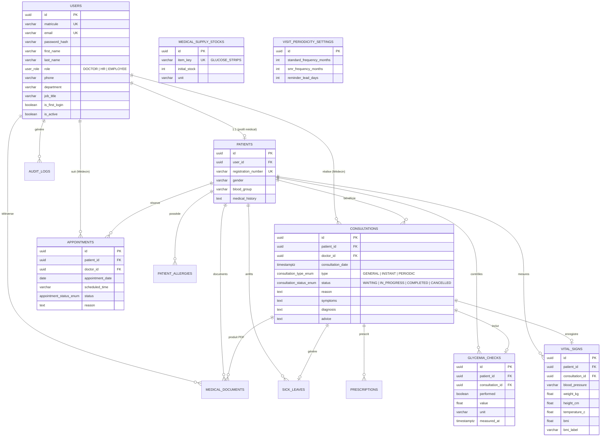
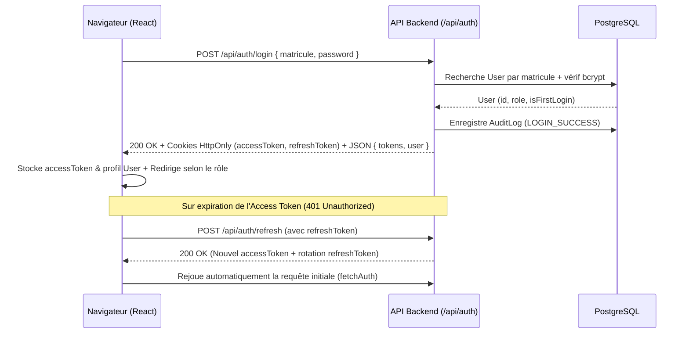

# Documentation Technique & Architecture — MedBCRG

## 1. Vue d'Ensemble de l'Architecture

L'application **MedBCRG** repose sur une architecture **3-tiers conteneurisée** (Client Web PWA / API REST Node.js / Base de données relationnelle PostgreSQL), orchestrée via **Docker Compose**.



---

## 2. Pile Technologique (Tech Stack)

### 2.1. Frontend (`MedBCRG/`)
| Composant | Technologie / Version | Rôle |
| :--- | :--- | :--- |
| **Framework UI** | React `^19.2.8` | Rendu déclaratif par composants et Hooks |
| **Langage** | TypeScript `~6.0.2` | Typage statique strict des contrats API et composants |
| **Bundler** | Vite `^8.3.0` | Compilation ultra-rapide et serveur de développement HMR |
| **Styles** | Tailwind CSS `^4.3.3` | Système de design utilitaire responsive |
| **Routage** | React Router DOM `^7.18.4` | Navigation SPA et protection des routes par rôle (`ProtectedRoute`) |
| **Icônes** | Lucide React `^1.48.0` | Iconographie médicale et administrative |
| **PWA** | `vite-plugin-pwa` `^1.3.0` | Génération du manifeste Web et Service Worker Workbox (`generateSW`) |
| **Serveur Prod** | Nginx Alpine | Service des fichiers statiques, fallback SPA (`try_files`) et proxy `/api/` |

### 2.2. Backend (`projet-backend-med_bcrg/`)
| Composant | Technologie / Version | Rôle |
| :--- | :--- | :--- |
| **Runtime** | Node.js `22-alpine` | Exécution JavaScript/TypeScript côté serveur |
| **Framework HTTP** | Express `^4.22.3` | Routage REST, middlewares de sécurité et gestion d'erreurs centralisée |
| **ORM & BDD** | Prisma `^7.10.1` + `@prisma/adapter-pg` | Accès typé à PostgreSQL 16 via pool de connexions `pg` |
| **Validation** | Zod `^3.25.76` | Validation stricte des schémas de requêtes (`body`, `query`, `params`) |
| **Authentification** | `jsonwebtoken` + `bcryptjs` | Tokens JWT (`accessToken` + `refreshToken` en cookies `HttpOnly`) et SSO BCRG Hub |
| **Sécurité HTTP** | `helmet`, `cors`, `express-rate-limit` | En-têtes de sécurité, contrôle d'origine et protection brute-force |
| **Moteur PDF** | `pdfkit` `^0.20.2` | Génération dynamique des ordonnances, certificats d'aptitude, repos et rapports RH |
| **Téléversement** | `multer` `^2.4.0` | Gestion multipart des documents médicaux avec validation MIME et taille |
| **Documentation API** | `swagger-ui-express` | Interface OpenAPI interactive exposée sur `/api/docs` |

---

## 3. Architecture Backend (Clean / Modular Layered Architecture)

Le backend est structuré en couches découplées sous `projet-backend-med_bcrg/src/` :

```text
projet-backend-med_bcrg/src/
├── app.ts                          # Configuration Express (Helmet, CORS, Cookies, Routes, ErrorHandler)
├── server.ts                       # Point d'entrée HTTP et gestion de l'arrêt gracieux (SIGTERM/SIGINT)
├── config/
│   ├── env.ts                      # Validation des variables d'environnement au démarrage
│   └── swagger.ts                  # Spécification OpenAPI 3.0
├── core/
│   ├── constants/                  # Rôles et constantes système
│   ├── errors/                     # Classes d'erreurs métier (AppError, UnauthorizedError, ForbiddenError...)
│   ├── middlewares/                # Middlewares Express (authenticate, authorizeRoles, validate, upload, errorHandler)
│   └── utils/                      # Utilitaires (hachage bcrypt, JWT, formatage de réponse apiResponse)
├── infrastructure/
│   ├── database/
│   │   ├── prisma.ts               # Singleton PrismaClient avec adaptateur PostgreSQL
│   │   └── seed.ts                 # Ensemencement initial (comptes 2007, 2008, 2009, bandelettes, périodicité)
│   └── pdf/                        # Générateur PDF officiel avec en-tête et charte graphique BCRG
└── modules/                        # Modules métiers (Controller -> Service -> Validation -> Routes)
    ├── auth/                       # Connexion locale, SSO BCRG Hub, Refresh Token, Changement MDP initial
    ├── consultations/              # Consultations, constantes, glycémie, ordonnances, certificats, repos PDF
    ├── dashboard/                  # Agrégations et KPIs du portail Médecin (incluant suivi diabète)
    ├── doctor-agenda/              # Agenda médecin, créneaux horaires, approbation/report/annulation RDV
    ├── hr/                         # Dashboard RH, statistiques par direction, diabète RH, périodicité, rapport PDF
    ├── patient-portal/             # Espace collaborateur : mes RDV, créneaux libres, mes constantes, mes documents
    └── patients/                   # Gestion des employés/patients, dossier médical complet, allergies, documents
```

---

## 4. Modèle de Données (Schéma Relationnel PostgreSQL / Prisma)

Le schéma de base de données ([`prisma/schema.prisma`](../projet-backend-med_bcrg/prisma/schema.prisma)) comprend **13 tables** principales :



---

## 5. Sécurité, Authentification et Contrôle d'Accès (RBAC)

### 5.1. Flux d'Authentification Hybride (Cookies `HttpOnly` + Bearer Token + SSO)



- **Double transport des jetons** : Le backend émet les jetons à la fois dans des cookies sécurisés `HttpOnly` et dans le corps JSON (`tokens.accessToken`, `tokens.refreshToken`). Le client [`api.ts`](../MedBCRG/src/services/api.ts) utilise un wrapper `fetchAuth` qui injecte l'en-tête `Authorization: Bearer <token>`, envoie `credentials: 'include'` et rafraîchit automatiquement la session via `POST /api/auth/refresh` en cas d'expiration (`401`).
- **Fédération SSO BCRG Hub** : La route `POST /api/auth/sso` valide les jetons émis par le portail central BCRG Hub (via clé publique JWKS ou secret partagé `BCRG_HUB_JWT_SECRET`) et connecte automatiquement l'agent correspondant.

### 5.2. Cloisonnement Strict des Données (Secret Médical)
- Les routes `/api/doctor/*` sont protégées par `authorizeRoles(UserRole.DOCTOR)`.
- Les routes `/api/hr/*` sont protégées par `authorizeRoles(UserRole.HR)`. Elles ne retournent **aucune donnée clinique nominative** (ni diagnostic, ni symptôme, ni ordonnance, ni résultat glycémique individuel).
- Les routes `/api/patient/*` sont protégées par `authorizeRoles(UserRole.EMPLOYEE)` et filtrent systématiquement les données sur le `req.user.id` du collaborateur connecté (protection anti-IDOR).

---

## 6. Cartographie Complète des Endpoints API REST

### 6.1. Authentification (`/api/auth`)
| Méthode | Endpoint | Rôles | Description |
| :--- | :--- | :--- | :--- |
| `POST` | `/api/auth/login` | Public | Connexion par matricule et mot de passe |
| `POST` | `/api/auth/sso` | Public | Connexion fédérée via jeton SSO BCRG Hub |
| `POST` | `/api/auth/refresh` | Public | Rafraîchissement du jeton d'accès (`accessToken`) |
| `POST` | `/api/auth/logout` | Authentifié | Déconnexion et révocation des cookies de session |
| `GET` | `/api/auth/me` | Authentifié | Récupération du profil de l'utilisateur connecté |
| `POST` | `/api/auth/change-initial-password` | Authentifié | Changement du mot de passe temporaire initial |

### 6.2. Employés, Dossiers Patients & Allergies (`/api/employees` & `/api/doctor/patients`)
| Méthode | Endpoint | Rôles | Description |
| :--- | :--- | :--- | :--- |
| `GET` | `/api/employees` | `HR`, `DOCTOR` | Liste paginée et filtrée des employés/patients |
| `POST` | `/api/employees` | `HR`, `DOCTOR` | Création d'un employé et de son dossier patient |
| `GET` | `/api/employees/:id` | `HR`, `DOCTOR` | Détail administratif d'un employé |
| `PUT` | `/api/employees/:id` | `HR` | Mise à jour administrative (`phone`, `department`, `jobTitle`, `bloodGroup`, `medicalHistory`) |
| `GET` | `/api/employees/:id/medical-record` | `DOCTOR` | Dossier médical complet (constantes, glycémie, allergies, consultations) |
| `POST` | `/api/employees/:id/allergies` | `DOCTOR` | Ajout d'une allergie au dossier patient |
| `DELETE` | `/api/employees/:id/allergies/:allergyId` | `DOCTOR` | Suppression d'une allergie |
| `GET` | `/api/employees/:id/documents` | `DOCTOR` | Liste des documents médicaux du patient |
| `POST` | `/api/employees/:id/documents` | `DOCTOR` | Téléversement d'un document médical (`multipart/form-data`) |
| `GET` | `/api/employees/:id/documents/:docId/view` | `DOCTOR`, `EMPLOYEE` | Prévisualisation inline du PDF/image |
| `GET` | `/api/employees/:id/documents/:docId/download` | `DOCTOR`, `EMPLOYEE` | Téléchargement du fichier médical |

### 6.3. Portail Médecin : Dashboard, Consultations & Agenda (`/api/doctor`)
| Méthode | Endpoint | Rôles | Description |
| :--- | :--- | :--- | :--- |
| `GET` | `/api/doctor/dashboard` | `DOCTOR` | KPIs cliniques, KPIs diabète, passages mensuels, alertes et activité |
| `GET` | `/api/doctor/consultations` | `DOCTOR` | Liste filtrée des consultations (`status`, `type`, `date`, `search`) |
| `GET` | `/api/doctor/consultations/stats` | `DOCTOR` | Compteurs statistiques des consultations |
| `POST` | `/api/doctor/consultations` | `DOCTOR` | Création d'une consultation (avec constantes, glycémie et prescriptions) |
| `GET` | `/api/doctor/consultations/:id` | `DOCTOR` | Détail complet d'une consultation |
| `PATCH` | `/api/doctor/consultations/:id` | `DOCTOR` | Mise à jour d'une consultation (incluant `vitals.bloodGroup` et clôture) |
| `POST` | `/api/doctor/consultations/:id/prescription/pdf` | `DOCTOR` | Génération et archivage de l'ordonnance PDF |
| `POST` | `/api/doctor/consultations/:id/aptitude-certificate/pdf` | `DOCTOR` | Génération et archivage du certificat d'aptitude PDF |
| `POST` | `/api/doctor/consultations/:id/sick-leave/pdf` | `DOCTOR` | Génération et archivage du certificat de repos médical PDF |
| `GET` | `/api/doctor/agenda` | `DOCTOR` | Agenda médical sur la plage `startDate` (`YYYY-MM-DD`) – `endDate` (`YYYY-MM-DD`) |
| `GET` | `/api/doctor/agenda/available-slots` | `DOCTOR` | Créneaux horaires disponibles pour une date donnée |
| `POST` | `/api/doctor/agenda/appointments` | `DOCTOR` | Planification directe d'un rendez-vous par le médecin |
| `PATCH` | `/api/doctor/agenda/appointments/:id/approve` | `DOCTOR` | Validation/Confirmation d'une demande de rendez-vous |
| `PATCH` | `/api/doctor/agenda/appointments/:id/reschedule` | `DOCTOR` | Report d'un rendez-vous à une nouvelle date/heure |
| `PATCH` | `/api/doctor/agenda/appointments/:id/cancel` | `DOCTOR` | Annulation d'un rendez-vous avec motif |

### 6.4. Portail RH & Administration (`/api/hr`)
| Méthode | Endpoint | Rôles | Description |
| :--- | :--- | :--- | :--- |
| `GET` | `/api/hr/dashboard` | `HR` | KPIs globaux RH (effectif total, actifs, consultations du mois, arrêts en cours) |
| `GET` | `/api/hr/statistics` | `HR` | Statistiques RH par direction sur une période (`startDate`, `endDate`) |
| `GET` | `/api/hr/statistics/diabetes` | `HR` | Indicateurs anonymisés du suivi diabète et stock de bandelettes |
| `GET` | `/api/hr/periodicity/settings` | `HR` | Lecture des paramètres de périodicité (Standard, SMR, délai de relance) |
| `PUT` | `/api/hr/periodicity/settings` | `HR` | Mise à jour des règles de périodicité |
| `GET` | `/api/hr/periodicity/due-employees` | `HR` | Synthèse de couverture et liste des employés avec statut d'échéance |
| `GET` | `/api/hr/reports/export` | `HR` | Génération et téléchargement du rapport officiel RH au format PDF |

### 6.5. Portail Collaborateur / Patient (`/api/patient`)
| Méthode | Endpoint | Rôles | Description |
| :--- | :--- | :--- | :--- |
| `GET` | `/api/patient/appointments/available-days` | `EMPLOYEE` | Disponibilités quotidiennes sur un mois (`month=YYYY-MM`) |
| `GET` | `/api/patient/appointments/available-slots` | `EMPLOYEE` | Créneaux horaires libres sur une date (`date=YYYY-MM-DD`) |
| `GET` | `/api/patient/appointments/my` | `EMPLOYEE` | Liste des rendez-vous du collaborateur connecté |
| `POST` | `/api/patient/appointments` | `EMPLOYEE` | Réservation d'un nouveau rendez-vous médical |
| `PATCH` | `/api/patient/appointments/:id/cancel` | `EMPLOYEE` | Annulation d'un rendez-vous par le collaborateur (`{ reason }`) |
| `GET` | `/api/patient/vitals` | `EMPLOYEE` | Dernières constantes vitales et historique personnel |
| `GET` | `/api/patient/documents` | `EMPLOYEE` | Liste des documents médicaux personnels |
| `POST` | `/api/patient/documents/upload` | `EMPLOYEE` | Téléversement d'un document médical externe par le patient |

---

## 7. Infrastructure Docker & Variables d'Environnement

L'orchestration [`docker-compose.yml`](../docker-compose.yml) déploie trois services interconnectés sur le réseau privé `medbcrg-network` :

1. **`medbcrg-postgres`** (`postgres:16-alpine`) :
   - Persistance assurée par le volume nommé `medbcrg_postgres_data`.
   - Healthcheck natif via `pg_isready`.
2. **`medbcrg-backend`** (`node:22-alpine`) :
   - Compilation multi-stage TypeScript + génération du client Prisma.
   - Script d'entrée [`docker-entrypoint.sh`](../projet-backend-med_bcrg/docker-entrypoint.sh) exécutant automatiquement `npx prisma db push` (`AUTO_MIGRATE=true`) et le seed initial (`AUTO_SEED=true`) avant de démarrer le serveur Express sur le port interne `5000` (exposé sur `5003`).
   - Persistance des PDF générés et documents téléversés dans le volume nommé `medbcrg_uploads_data` (`/app/uploads`).
3. **`medbcrg-frontend`** (`node:20-alpine` -> `nginx:alpine`) :
   - Compilation multi-stage Vite + PWA Workbox.
   - Serveur Nginx configuré via [`MedBCRG/nginx.conf`](../MedBCRG/nginx.conf) (limite d'upload `client_max_body_size 25M`, compression Gzip, proxy transparent `/api/` vers `http://backend:5000/api/`).

